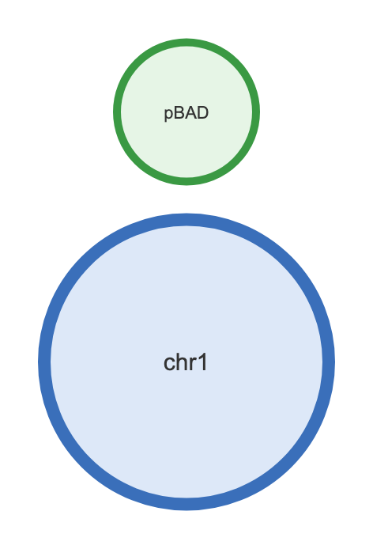
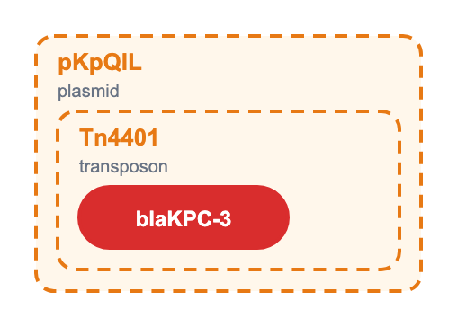
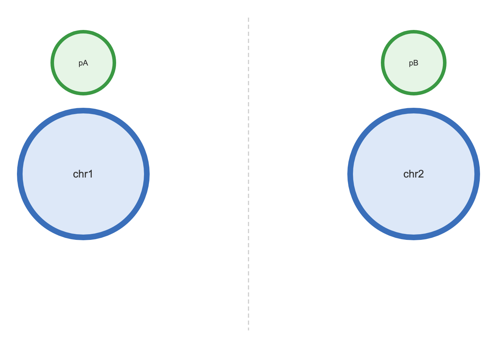
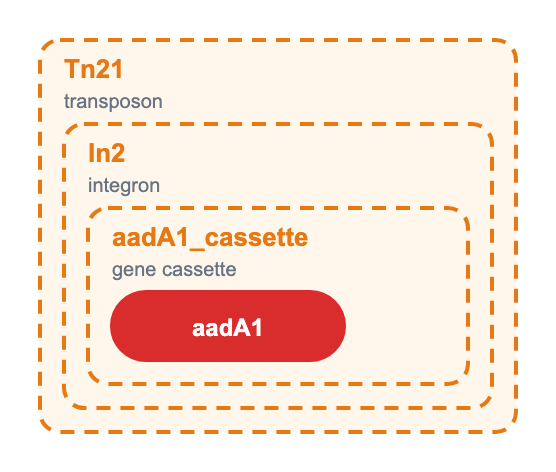
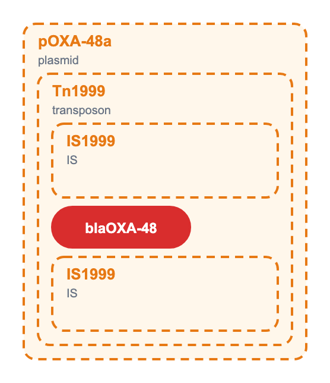

# CellGen

CellGen is a compact text format for describing cellular genome organisation. It records chromosomes, other biological entities such as plasmids and genes, and what is contained within them.

**[Open the visualiser](https://cell-format.vercel.app/)** to build a record, paste your own notation or import an annotated GenBank or GFF3 file.

## Reading the format

| Notation | Meaning |
| --- | --- |
| `(...)label` | A chromosome and the entities inside it |
| `{...}label` | Another biological entity and what it contains |
| `,` | Separates entities at the same level |
| `;` | Separates cells |
| `[key="value"]` | Adds attributes, such as a type or accession |

Parentheses mean chromosome, and only chromosome. Curly braces can represent any other biological entity; use a `type` attribute to state its class. Labels follow the closing bracket. Empty brackets mean that no contained entities are recorded.

## A chromosome and a plasmid

```text
()chr1, {}pBAD[type="plasmid"]
```

The chromosome and plasmid are separate entities in one cell.



## Nested containment

```text
{
  { {}blaKPC-3[type="gene"] }Tn4401[type="transposon"]
}pKpQIL[type="plasmid"]
```

The gene `blaKPC-3` is inside the transposon `Tn4401`, which is inside the plasmid `pKpQIL`. Nesting the brackets records those relationships directly.



## Two cells

```text
()chr1, {}pA[type="plasmid"] ; ()chr2, {}pB[type="plasmid"]
```

A semicolon separates the cells. Each cell here contains a chromosome and a plasmid.



These images are static exports from the visualiser's circular and containment views.

## Examples from the manuscript

The manuscript uses three published structures to demonstrate nested containment. The notation below shows the entities and their types; the [full records](examples/published_structures/README.md) also retain source annotations, including coordinates where available.

### Tn21

The transposon Tn21 contains the integron In2, which contains an `aadA1` gene cassette and its gene. See [Liebert et al. (1999)](https://doi.org/10.1128/MMBR.63.3.507-522.1999) and the [full Tn21 record](examples/published_structures/Tn21.cellgen).

```text
{
  {
    { {}aadA1[type="gene"] }aadA1_cassette[type="gene_cassette"]
  }In2[type="integron"]
}Tn21[type="transposon", accession="AF071413.3"]
```



### pKpQIL

The plasmid pKpQIL contains Tn4401a, with `blaKPC-3`, ISKpn7 and ISKpn6 represented inside the transposon. See [Leavitt et al. (2010)](https://doi.org/10.1128/AAC.00175-10) and the [full pKpQIL record](examples/published_structures/pKpQIL.cellgen).

```text
{
  {
    {}ISKpn7[type="IS"],
    {}blaKPC-3[type="gene"],
    {}ISKpn6[type="IS"]
  }Tn4401a[type="transposon"]
}pKpQIL[type="plasmid", accession="GU595196.1"]
```


### pOXA-48a

The plasmid pOXA-48a contains Tn1999, with `blaOXA-48` and two copies of IS1999 represented inside the transposon. See [Poirel et al. (2012)](https://doi.org/10.1128/AAC.05289-11) and the [full pOXA-48a record](examples/published_structures/pOXA-48a.cellgen).

```text
{
  {
    {}IS1999[type="IS", copy="1"],
    {}blaOXA-48[type="gene"],
    {}IS1999[type="IS", copy="2"]
  }Tn1999[type="transposon"]
}pOXA-48a[type="plasmid", accession="JN626286.1"]
```



The [query example](examples/published_structures/README.md) retrieves each gene's enclosing cassette, integron, transposon and plasmid from these records. The manuscript's [Figure 3](figures/Figure_3_published_structures.png) shows the three structures together.

## Grammar

In this EBNF, quoted punctuation is literal, square brackets mark optional content, and braces mark repetition.

```ebnf
Document        = Cell , { ";" , Cell } ;
Cell            = CellularElement , { "," , CellularElement } ;
CellularElement = Chromosome | Entity ;
Chromosome      = "(" , [ EntitySet ] , ")" , Annotation ;
Entity          = "{" , [ EntitySet ] , "}" , Annotation ;
EntitySet       = Entity , { "," , Entity } ;
Annotation      = [ Label ] , [ Attributes ] ;
Attributes      = "[" , KeyValue , { "," , KeyValue } , "]" ;
KeyValue        = Key , "=" , Quoted ;
Label           = BareLabel | Quoted ;
```

A bare label uses letters, digits, underscores, dots, colons or hyphens. Labels containing spaces or reserved punctuation must be double-quoted, for example `{}"resistance gene"[type="gene"]`. Attribute values are double-quoted strings; attribute keys start with a letter or underscore and use the same characters as bare labels.

Each cell contains at least one top-level chromosome or entity. Chromosomes cannot be nested, but other entities can be nested to any depth. Commas separate siblings and attributes; semicolons separate cells. Whitespace and line breaks between tokens are optional, so the examples above can also be written on one line.

See the [format specification](docs/specification.md) for escaping and validation rules.

## Documentation

- [Web visualiser](docs/visualiser.md): build and edit records, import annotations, export diagrams and run the app locally.
- [Python](docs/python.md): installation, parser API and command-line tools.
- [TypeScript](docs/typescript.md): parser and renderer APIs, and integration with other applications.
- [Format specification](docs/specification.md): grammar, labels, attributes and syntax rules.
- [More examples](docs/examples.md) and [published biological structures](examples/real_world.md).
- [GenBank and GFF3 import](docs/import.md): annotation handling and import options.
- [Validation](docs/validation.md): diagnostics and conformance checks.

## Authors

Centre for Genomic Pathogen Surveillance, University of Oxford

- Julio Diaz Caballero
- Nabil-Fareed Alikhan
- Khalil AbuDahab
- Sophia David
- David Aanensen
